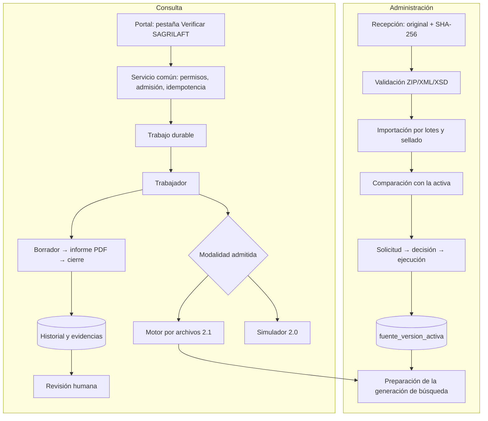

# Módulo de consultas a listas cautelares: arquitectura

Estado verificado contra el código el 2026-11-13. Si este documento y el código
difieren, manda el código; corrige el documento en el mismo cambio.

Documentos relacionados:

- [Reglas de búsqueda y casos de aceptación](BUSCADOR_REGLAS_Y_CASOS.md): cómo
  se clasifican los candidatos (ALTA/MEDIA/BAJA) y qué casos lo comprueban.
- [Operación, pruebas y pendientes](OPERACION_PRUEBAS_Y_PENDIENTES.md): cómo se
  configura, cómo se carga OFAC, cómo se prueba y qué falta antes de usarlo en serio.
- [Consultas con Tusdatos](TUSDATOS.md): guía corta de la modalidad externa, pensada
  para quien revisa resultados o atiende la operación.

Convención de estado usada en los tres documentos:

| Marca | Significa |
|---|---|
| **Implementado** | Existe en el código y tiene pruebas |
| **Pendiente** | Decidido o necesario, pero no construido |
| **Propuesto** | Valor o regla sugerida que nadie ha aprobado |
| **Retirado** | Existió; hoy no se ejecuta o no se debe usar |

---

## 1. Qué hace el módulo y qué no hace

El módulo consulta si una contraparte (empresa o persona natural, cliente o
proveedor) o su representante legal aparece en listas cautelares, conserva lo
consultado y lo encontrado, y permite que un analista registre su revisión.

No decide nada sobre el expediente. Una coincidencia, incluso ALTA, es una alerta
para revisión humana: no aprueba, no rechaza, no asigna nivel de riesgo y no cambia
el estado del formulario. Un error técnico o una fuente no disponible nunca se
presenta como «sin coincidencias».

Tiene dos procesos que no se mezclan:

- **Administración de listas:** recibir un archivo oficial descargado a mano,
  validarlo, importarlo como versión sellada, compararlo con la versión activa y
  activarlo o restaurar una anterior.
- **Consulta:** buscar a un sujeto de un expediente contra las fuentes activas,
  guardar el resultado con su evidencia y registrar la revisión humana.

Una consulta nunca importa ni activa listas, y una importación nunca decide
sobre una contraparte.

Cada resultado tiene cuatro niveles que no se mezclan:

| Nivel | Valores | Responsable |
|---|---|---|
| Ejecución técnica | PENDIENTE, EN_CURSO, COMPLETADA, PARCIAL, FALLIDA, INDETERMINADA | Servicio y adaptador |
| Resultado de búsqueda | SIN_CANDIDATOS, CON_CANDIDATOS, NO_CONCLUYENTE; y por candidato ALTA/MEDIA/BAJA | Motor o adaptador |
| Revisión humana | DESCARTADA, IDENTIDAD_CORROBORADA, REQUIERE_INFORMACION (sin revisión se muestra pendiente) | Analista con permiso |
| Decisión comercial o de cumplimiento | La que defina la organización | Proceso de cumplimiento, **fuera del módulo** |

Corroborar una identidad no equivale a concluir que una sanción aplica ni a rechazar
el expediente. El informe se llama «informe de consulta», nunca certificado de no
inclusión (OFAC no emite esos certificados).

## 2. Modalidades de consulta y su estado real

La modalidad se elige por entorno con `LISTAS_IMPLEMENTACION` (sección 7). Cada
consulta guarda la modalidad con la que se admitió, así que cambiar la variable
no altera el historial.

| Modalidad | Valor | Contrato | Estado |
|---|---|---|---|
| Dummy (simulador) | `simulado` | 2.0 | **Implementado.** `infrastructure/listas/simulado.py`. Devuelve un escenario fijo para todo el entorno (`LISTAS_SIMULACION_ESCENARIO`), no depende de los datos consultados. Todo resultado lleva la advertencia `SIMULADO` |
| Local por archivos | `archivos` | 2.1 | **Implementado, solo en `development` y `test`.** `infrastructure/listas/consultor_archivos.py` y `services/listas/motor_busqueda.py`. Busca en versiones importadas por nosotros (hoy OFAC SDN Advanced) |
| Proveedor externo (Tusdatos) | `externo` | 2.0 | **Implementado y probado con el sandbox y respuestas grabadas; sin credenciales reales todavía.** `services/listas/modalidad_externa.py` e `infrastructure/listas/tusdatos/`. Producción sigue bloqueada por `validar_entorno` |
| Deshabilitado | `deshabilitado` | — | **Implementado.** Rechaza nuevas consultas (HTTP 409); el historial sigue accesible |

### Circuito anterior (retirado)

Antes de v2 existían dos caminos: la verificación del expediente con
`ConsultorListasCautela` (dummy por prefijos, cliente Tusdatos en
`infrastructure/servicios_externos/sagrilaft/real.py`) y `ListaCautelaService`
con proveedores en memoria que calculaba un riesgo contando listas. Hoy:

- `POST /api/expedientes/{id}/verificar-sagrilaft`, `GET /api/expedientes/{id}/sagrilaft/pdf`
  y `POST /api/listas-cautela/buscar` responden **410** después de autenticar.
- `GET /api/expedientes/sagrilaft/disponibilidad` sigue activo solo como dato informativo.
- Se retiraron las etiquetas automáticas `APROBADO_SAGRILAFT` y `RECHAZADO_SAGRILAFT` y el
  riesgo ALTO/MEDIO/BAJO del dummy antiguo, que respondía según el prefijo del documento
  (999, 888, 777 y 000 para error). El formulario público ya no tiene el método de
  búsqueda de listas, y la validación documental ya no consulta listas.
- El código antiguo sigue en el repositorio pero no está conectado a ninguna ruta
  de consulta. Su retiro definitivo está pendiente (ver
  [pendientes](OPERACION_PRUEBAS_Y_PENDIENTES.md#7-pendientes)).
- `formularios.sagrilaft_reporte_id` y las filas `resultado_validacion` de tipo
  `lista_cautela` se conservan como **legado**. El historial las muestra aparte,
  sin versión ni evidencia, y la revalidación documental ya no las borra.

## 3. Componentes

| Capa | Archivos principales | Responsabilidad |
|---|---|---|
| Dominio | `backend/domain/listas/` (`contratos.py`, `contratos_busqueda.py`, `datos_busqueda.py`, `administracion.py`, `catalogo_fuentes.py`, `catalogos_busqueda.py`, `comparacion_*.py`, `puertos*.py`, `errores.py`) | Contratos, hechos comunes, catálogos, comparadores puros y errores. Sin dependencias de FastAPI ni SQLAlchemy |
| Servicios | `backend/services/listas/` | Política y permisos (`politica_v2.py`), servicio común de consultas (`servicio_comun.py`, `servicio_archivos_portal.py`, `admision_archivos.py`, `preparacion_criterios.py`), motor (`motor_busqueda.py`), recepción, validación, importación, comparación y administración de versiones, informes PDF y trabajadores |
| Infraestructura | `backend/infrastructure/listas/` | Adaptadores de archivo (sintético y OFAC), lectores para búsqueda, simulador, consultor por archivos, custodia local, fábrica y trabajador local |
| Persistencia | `backend/infrastructure/persistencia/modelos_*listas*.py` y `repositorios/{consultas,busqueda,administracion}_listas.py` | 41 tablas, restricciones e invariantes |
| API | `backend/api/routers/{consultas_listas,recepciones_listas,administracion_versiones}.py`, `backend/api/dependencias_listas.py`, `backend/api/schemas/listas_v2.py` | Rutas autenticadas (sección 9) |
| Portal | `frontend/apps/portal-interno/src/components/expedientes/VistaVerificarSagrilaft/` y `DetalleExpediente/{ConsultasListas,ConsultaForm,ResultadoConsultaListas,RevisionHistorial}.jsx`, `services/listas.js` | Pestaña «Verificar SAGRILAFT»: buscar expediente, consultar, seguir el progreso, ver resultados, descargar el informe y registrar la revisión |

El panel de consultas ya no está en el detalle del expediente: se abre desde la
pestaña **Verificar SAGRILAFT**, después de elegir un expediente.

## 4. Contratos

Hay dos contratos que conviven. El 2.1 no reemplaza al 2.0: añadir campos al 2.0
habría cambiado el cuerpo canónico y el hash de idempotencia de solicitudes ya
guardadas, así que se creó un contrato paralelo.

### 4.1 Contrato 2.0 (`domain/listas/contratos.py`)

Lo usa el simulador y es el previsto para el proveedor externo.

- **Solicitud** `CrearConsultaV2`: `version_contrato="2.0"`, `contexto` y `criterio`.
  - `contexto` EXPEDIENTE: `expediente_id`, `sujeto_rol` (CONTRAPARTE/REPRESENTANTE),
    `motivo` opcional. INDEPENDIENTE: `motivo` obligatorio (10–500 caracteres); hoy
    deshabilitado.
  - `criterio`: `tipo_sujeto` (PERSONA, ENTIDAD, BUQUE, AERONAVE, NO_DETERMINADO),
    `nombre`, `nombres_adicionales` (≤10), `identificadores` (≤10; tipo, valor,
    `pais_emisor`), `fecha_nacimiento`, `fecha_expedicion`, `nacionalidades`,
    `ubicacion`. Exige un nombre o un identificador utilizable. Rechaza campos
    desconocidos.
- **Resultado** `ResultadoProveedorV2`: `estado_ejecucion`, `conclusion_busqueda`,
  `cobertura`, `candidatos`, `hallazgos_no_estructurados`, `advertencias`,
  `criterios_no_aplicados`, fechas y `error`.
- **Evidencias** tipadas: `INFORME_INTERNO`, `MANIFIESTO`, `RESPUESTA_ORIGINAL`,
  `PDF_PROVEEDOR`, con estado y SHA-256. Hoy solo se genera `INFORME_INTERNO`.

| Estado de ejecución | Conclusión permitida |
|---|---|
| PENDIENTE, EN_CURSO | Ninguna, sin fecha final |
| COMPLETADA | SIN_CANDIDATOS solo si toda la cobertura requerida quedó CONSULTADA y no hay candidatos ni hallazgos; CON_CANDIDATOS si los hay |
| PARCIAL, FALLIDA, INDETERMINADA | Siempre NO_CONCLUYENTE (puede conservar candidatos parciales) |

Invariantes que valida el propio modelo: deshabilitado o con error no puede ser
COMPLETADA; un candidato no puede apuntar a una cobertura ajena; un resultado de
archivos exige versión, hash, fuente y revisión en cada cobertura consultada; un
resultado simulado debe llevar la advertencia `SIMULADO`. `ConsultaV2` exige además
un informe interno disponible para cerrar COMPLETADA o PARCIAL.

### 4.2 Contrato 2.1 (`domain/listas/contratos_busqueda.py`)

Lo usa la modalidad por archivos.

- `CriterioBusqueda` admite solo PERSONA, ENTIDAD y NO_DETERMINADO, y añade
  identificadores con `esquema` y `digito_verificacion`, `ciudadanias`,
  `ubicaciones` con rol y `campos_exigidos` (no se puede exigir un dato no informado).
- `CandidatoClasificado` lleva `nivel` (ALTA/MEDIA/BAJA), `regla_codigo`,
  `regla_version`, `explicacion`, `motivos` (cada uno COINCIDE, COMPATIBLE, DIFERENTE,
  AUSENTE o NO_APLICADO, con valor consultado, valor de la fuente, calidad y
  referencia de origen), `revision_prioritaria`, hechos, nombres, identificadores y
  relaciones del registro. **No tiene campos de puntaje.**
- Todo candidato necesita al menos un motivo positivo, y todas sus referencias deben
  apuntar a la misma fuente, versión y registro de su cobertura.
- `ManifiestoBusqueda` fija política, reglas, algoritmo, catálogos, parámetros y,
  por fuente, versión, revisión, hash de contenido y generación de búsqueda.
- `generador_informe_version`: `informe-listas-f6-v2` para resultados nuevos;
  `informe-listas-v1` para los anteriores.
- Límites de los datos 2.1 (`datos_busqueda.py`): 4.000 caracteres por texto o nombre y
  2.048 por identificador. Excederlos falla la validación; no se trunca. El 2.0 conserva
  sus límites (500 y 128).
- Un consumidor estricto 2.0 rechaza un cuerpo 2.1: conviven, pero no son
  intercambiables. El hash de una solicitud 2.0 histórica está fijado en
  `tests/fixtures/listas_f61/solicitud_20.json` para detectar cambios accidentales.

## 5. Datos y garantías de persistencia

Cadena de migraciones del módulo (todas aditivas, sobre `f8a9b0c1d2e3`):

| Revisión | Qué agrega |
|---|---|
| `a21b34c56d78` | Base: catálogo, versiones, registros, administración, consultas, trabajos, borradores e historial (28 tablas) |
| `b32c45d67e89` | Grupos de consultas (contraparte + representante) |
| `c43d56e78f90` | Reservas y eventos de recepción |
| `d54e67f890a1` | Vínculos recepción–versión, control de escritor e historial de lotes |
| `e65f78a901b2` | Solicitudes, trabajos de comparación, operaciones idempotentes y eventos administrativos |
| `f76a89b012c3` | Límite de 256 MiB solo para OFAC Advanced en `ofac_sdn` |
| `g87b90c123d4` | Comprobación del avance de importación sin repetirla por cada atributo |
| `h98c01d234e5` | Índice `ix_relacion_registro_origen` |
| `i09d12e345f6` | Representación de búsqueda: generación, registros y términos |
| `j10e23f456a7` | Comprobación agrupada al cerrar una generación |
| `k21f34a567b8` | Permite que el mismo usuario cargue y apruebe (sección 10) |

Grupos de tablas: catálogo (`fuente_lista`, `politica_listas`, `esquema_fuente`,
`archivo_fuente`, `comprobacion_fuente`); recepción e importación
(`recepcion_fuente`, `reserva_recepcion_lista`, `evento_recepcion_lista`,
`intento_importacion`, `recepcion_version_lista`, `control_importacion_version`,
`lote_importacion_lista`); versión y registros (`version_fuente`, `registro_lista`
y sus tablas de nombres, identificadores, direcciones, atributos y relaciones);
administración (`comparacion_version`, `revision_comparacion`,
`fuente_version_activa`, `evento_activacion`, `evento_version` y las cuatro de F5.5);
búsqueda (`generacion_busqueda_lista`, `registro_busqueda_lista`,
`termino_busqueda_lista`); consultas (`consulta_lista`, `consulta_fuente`,
`coincidencia_lista`, `hallazgo_proveedor`, `evidencia_consulta`,
`revision_cumplimiento`, `evento_consulta`, `trabajo_consulta`,
`borrador_consulta`, `grupo_consulta_lista`).

Garantías que aplica la base de datos, no solo el servicio:

- **Inmutabilidad.** Versiones selladas, lotes, resultados finales, eventos,
  solicitudes, decisiones y revisiones no admiten UPDATE ni DELETE. Una corrección
  es un registro nuevo vinculado al anterior. El rol de aplicación no debe ser
  propietario de las tablas ni poder desactivar triggers.
- **Claves foráneas compuestas.** Impiden vincular una coincidencia a un registro
  de otra versión, una activación a una versión de otra fuente o un grupo a hijos
  de otro expediente.
- **Puntero de versión activa.** `fuente_version_activa` existe desde que se crea la
  fuente (versión nula, revisión 0). Cada activación o restauración suma exactamente
  1 a la revisión, de modo que una comparación vieja nunca vuelve a servir, ni
  siquiera en un ciclo V1 → V2 → V1.
- **`implementacion`** de una consulta solo puede ser `simulado`, `archivos` o
  `externo`. Un trigger impide atribuir una versión local a un resultado externo o
  simulado.
- **Downgrade protegido.** Las migraciones del módulo rechazan la reversión si ya
  hay historial.
- **Sin borrado en cascada.** `consulta_lista.expediente_id` referencia `formularios.id`
  con `ondelete=RESTRICT`: no se puede borrar un expediente que tenga consultas. Los
  catálogos, archivos y versiones también usan RESTRICT. No existe purga ni retención
  automática.
- **Límite de la protección.** Triggers y restricciones protegen frente al rol de
  aplicación. El propietario de la base o un superusuario puede alterar el esquema o los
  datos; el módulo no promete inmutabilidad frente a ellos.
- **Índice de búsqueda.** `termino_busqueda_lista` guarda claves derivadas de nombres
  (NFC, sin distinguir mayúsculas) y documentos (NFC, conservando ceros, letras,
  separadores y dígito), con el índice `ix_termino_generacion_valor (generacion_id,
  clase, huella_valor)`. Solo sirve para recuperar candidatos exactos; el motor compara
  después el valor completo. No hay índice de similitud ni extensiones de PostgreSQL.
- **Tabla sin uso.** `comprobacion_fuente` (comprobación manual de vigencia con
  resultado `SIN_CAMBIOS`, `CAMBIO_DETECTADO` o `FALLIDA`) existe desde la migración
  base, pero **ningún servicio ni ruta la usa**. La política de vigencia que la usaría
  es una propuesta (P02, sección 12).

Estados principales:

| Objeto | Estados |
|---|---|
| Recepción | `PENDIENTE` → `RECIBIDA` o `FALLIDA`. RECIBIDA solo significa que el original se guardó; no que esté validado |
| Intento de importación | `PENDIENTE` → `EN_CURSO` → `COMPLETADO` o `FALLIDO`, con fases `VALIDACION`, `IMPORTACION`, `COMPROBACION` y `SELLADO`. COMPLETADO exige sellado y al menos un registro; un intento terminal no se reabre |
| Versión | `EN_CONSTRUCCION` → `VALIDA` → `BLOQUEADA`. Una versión sellada no se reescribe; repararla exige otra generación (no implementado) |
| Generación de búsqueda | `PREPARANDO` (nunca se confirma) → `LISTA` |
| Consulta | Estados del contrato (sección 4.1); fase del trabajo `ADMISION` → `BUSQUEDA` → `PREPARANDO_EVIDENCIA` → `CERRANDO` → `FINALIZADA` |

No hay transacción distribuida entre la custodia (disco) y SQL. Siempre se guarda
primero el archivo, con una clave inmutable igual a su SHA-256, y después se confirma
su referencia en SQL. Si SQL falla, el archivo queda huérfano y privado: el reintento lo
reutiliza y `/conciliacion` lo cuenta, pero nunca se publica como evidencia ni se borra
automáticamente. Nunca se sobrescribe un archivo referenciado.

Las bases desechables de pruebas usan PostgreSQL 17.9. La compatibilidad con la
versión de PostgreSQL de cada ambiente no se ha verificado.

## 6. Cómo fluye una consulta

1. **Admisión** (una transacción). Se valida el JWT, el permiso y el acceso al
   expediente; se reserva la `Idempotency-Key` por actor y contexto; se guardan la
   consulta, su criterio original, el manifiesto y el trabajo. En modo archivos se
   fijan aquí las versiones activas y sus generaciones de búsqueda. La API responde
   **202** solo después del commit. Misma clave y mismo cuerpo devuelven la misma
   consulta; misma clave con otro cuerpo, **409**.
2. **Ejecución.** El trabajador reclama el trabajo con una concesión (120 s) y un
   número de control creciente. Ejecuta el adaptador indicado por el manifiesto
   admitido, no por la configuración actual.
3. **Borrador.** El resultado normalizado se guarda primero como borrador durable.
4. **Informe.** Se genera el PDF desde el borrador, se guarda en la custodia por
   SHA-256 (fuera de transacciones SQL) y se registra en el borrador.
5. **Cierre** (una transacción). Se insertan resultado, coberturas, coincidencias,
   evidencia y estado final. Un trabajador con concesión vencida no puede cerrar.

Si el proceso cae después del borrador, el siguiente intento reutiliza ese
resultado y ese PDF sin volver a buscar. Si una consulta **externa** se reclamó y
venció sin borrador, se cierra `INDETERMINADA / EFECTO_EXTERNO_DESCONOCIDO` y no se
vuelve a llamar al proveedor (repetir una llamada facturable no es seguro).

Códigos de fallo que registra el trabajador: `IMPLEMENTACION_NO_DISPONIBLE`,
`CUSTODIA_NO_DISPONIBLE`, `RECETA_O_VERSION_NO_DISPONIBLE`,
`INTEGRIDAD_O_CUSTODIA_NO_DISPONIBLE`, `DATOS_ADMITIDOS_NO_INTERPRETABLES` y
`EFECTO_EXTERNO_DESCONOCIDO`.

Otras reglas:

- Activar o restaurar una versión no cambia consultas ya admitidas: terminan con la
  versión fijada. Si esa versión se **bloquea** por integridad antes del cierre, no se
  publica un resultado concluyente.
- Descargar un informe devuelve los bytes guardados tras verificar hash y tamaño; nunca
  se regenera ni se vuelve a consultar. Si el archivo falta o no cuadra, la API responde
  503 y no entrega nada.
- La consulta de **contraparte y representante** crea un grupo y dos consultas
  independientes en una sola admisión. Un sujeto sin datos utilizables aparece como
  «no consultado» con su motivo. En modo archivos los datos salen del expediente
  guardado (sección 2 de [reglas](BUSCADOR_REGLAS_Y_CASOS.md#2-de-dónde-salen-los-datos-consultados)).
- La consulta **individual** usa el nombre y el documento editados en pantalla y no
  les añade datos personales guardados, porque podrían ser de otra persona.

## 7. Selección de modalidad y configuración

`SagrilaftListasConfig` (`infrastructure/config/configuracion.py`) resuelve una sola
modalidad al arrancar:

- `LISTAS_IMPLEMENTACION` = `deshabilitado` | `simulado` | `archivos` | `externo`.
- `PROVEEDOR_LISTAS_CAUTELA` (heredada) se traduce: `dummy` → `simulado`,
  `sagrilaft` → `externo`, `deshabilitado` → `deshabilitado`. Vacía con la nueva
  presente se ignora.
- Valores desconocidos o contradictorios entre ambas variables impiden arrancar.
- Sin ninguna de las dos: `deshabilitado`.
- `simulado` exige `LISTAS_SIMULACION_ESCENARIO` (`sin_coincidencias_v1`,
  `coincidencia_v1`, `parcial_v1`, `error_v1`). Si la modalidad viene solo de la
  variable heredada `dummy`, se usa `sin_coincidencias_v1`.
- **Producción:** `validar_entorno` rechaza cualquier modalidad distinta de
  `deshabilitado` y la administración habilitada. Habilitar producción exige cambiar
  esa regla, por decisión expresa.

**Registro único de modalidades** (`backend/services/listas/modalidades.py`). La
configuración solo elige el nombre; lo que significa cada modalidad lo declara su
entrada en `MODALIDADES`: contrato (`2.0` o `2.1`), disponibilidad, admisión
individual y de grupo, reconocimiento de reintentos y ejecución en el trabajador.

- El servicio común, `GET /api/listas/disponibilidad` y el trabajador consultan el
  registro; ninguno compara nombres de implementación.
- `deshabilitado` o una modalidad sin entrada responden «no disponible»; nunca se
  sustituyen por otra. `externo` sin `LISTAS_TUSDATOS_*` válidas tampoco está disponible.
- El trabajador ejecuta cada consulta con la modalidad que la **admitió** (según lo
  guardado en la consulta), no con la configurada ahora.
- Un reintento con la misma `Idempotency-Key` se responde con la consulta original
  aunque la configuración haya cambiado después.
- `disponibilidad` devuelve `version_contrato`; el portal la usa para elegir el
  contrato al crear la consulta.

Restricciones adicionales por modalidad:

| Modalidad | Requisitos | Entornos donde el código lo permite |
|---|---|---|
| `simulado` | Escenario | Todos menos producción |
| `archivos` | `LISTAS_ARCHIVOS_LOCAL_HABILITADA=true`, `LISTAS_ARCHIVOS_FUENTES` (sin duplicados), `LISTAS_ARCHIVOS_POLITICA_ID` (política con `solo_pruebas: true`), cada fuente con versión activa y generación preparada | Solo `development` y `test` |
| Administración | `LISTAS_ADMIN_HABILITADA=true`, `LISTAS_ADMIN_POLITICA_ID`, fuente habilitada (`LISTAS_ARCHIVOS_FUENTES_HABILITADAS`, o `LISTAS_OFAC_LOCAL_HABILITADA=true` para añadir `ofac_sdn` a la sintética `ofac_sdn_prueba`) | Solo `development`, `local` y `test` |
| Custodia | `LISTAS_CUSTODIA_DIRECTORIO`; sin ella las rutas responden 503 | — |

`GET /api/listas/disponibilidad` informa a la sesión si puede consultar, ver el
historial y revisar, y la modalidad activa. «Consultar» solo es verdadero en
`simulado`, o en `archivos` con su configuración completa.

## 8. Seguridad y permisos

- **Identidad.** Todas las rutas usan `portal_interno` (firma, emisor, audiencia,
  cliente, sujeto y `exp` obligatorio; un JWT sin `exp` o con `exp=null` recibe 401).
  El actor se identifica por `issuer` y `sub`, nunca por datos del cuerpo. Las
  operaciones administrativas vuelven a validar el JWT antes de confirmar una mutación.
- **Acceso a expedientes.** Además del permiso de listas, se exige `acceso_clientes`
  o `acceso_proveedores` según el tipo de contraparte, comprobado sobre el expediente
  real en cada lectura y escritura.
- **Permisos por rol** (`services/listas/politica_v2.py`). Los roles existen en el
  código; **no se ha verificado que estén creados en el Keycloak de ningún ambiente**.

| Rol | Permisos |
|---|---|
| `listas_operador` | `listas.consultar`, `listas.ver_evidencias` |
| `listas_revisor` | los anteriores + `listas.revisar`, `listas.ver_pdf_proveedor` (PDF del proveedor) y `listas.forzar_actualizacion` (consulta externa nueva) |
| `listas_cargador` | `listas.importar`, `listas.comparar`, `listas.ver_administracion` |
| `listas_aprobador` | `listas.comparar`, `listas.ver_administracion`, `listas.aprobar_version`, `listas.activar_version` |
| `listas_incidentes` | `listas.ver_administracion`, `listas.bloquear_version`, `listas.reconstruir_version` |
| `listas_busqueda_independiente` | `listas.consultar_independiente`, `listas.ver_evidencias` |

- La búsqueda independiente (sin expediente) existe en el contrato y la política,
  pero no hay ruta que la admita y `LISTAS_BUSQUEDA_INDEPENDIENTE_HABILITADA` está
  apagada por defecto.
- Los logs registran identificadores y códigos, no tokens, XML ni documentos completos.
  Las denegaciones 401/403/404 de recepción quedan registradas en los logs (no en la base)
  con código, correlación, recurso e identidad. Si el JWT no se pudo validar, la identidad
  figura como `IDENTIDAD_NO_VERIFICADA`. Las operaciones confirmadas sí tienen auditoría
  en la base, dentro de la misma transacción. La retención centralizada de esos logs no
  está definida.
- Las respuestas llevan `Cache-Control: private, no-store`. Las descargas usan
  `nosniff` y nunca exponen la clave física de la custodia.

## 9. Rutas HTTP

Errores comunes (`RutaListas`): 401 identidad; 403 permiso; 404 objeto inexistente o
ajeno; 409 conflicto, idempotencia o modalidad no disponible; 413 tamaño; 422 datos no
válidos; 503 custodia o evidencia sin integridad.

**Consultas** (`/api`):

| Método y ruta | Uso |
|---|---|
| GET `/listas/disponibilidad` | Capacidades de la sesión |
| POST `/expedientes/{id}/consultas-listas` | Consulta individual. Cabecera `Idempotency-Key`. Cuerpo 2.0, o 2.1 con `version_contrato: "2.1"` en modo archivos |
| POST `/expedientes/{id}/consultas-listas/grupos` | Contraparte y representante con los datos guardados |
| GET `/expedientes/{id}/consultas-listas?antes=&limite=` | Historial paginado por cursor, más el legado |
| GET `/consultas-listas/{id}` | Detalle, revisiones y, en 2.1, trazabilidad del manifiesto |
| GET `/consultas-listas/{id}/evidencias/{evidencia_id}` | PDF conservado |
| POST `/consultas-listas/{id}/revisiones` | Revisión humana: DESCARTADA, IDENTIDAD_CORROBORADA o REQUIERE_INFORMACION, con justificación y, opcionalmente, candidato y revisión que corrige |

**Administración** (`/api/administracion-listas`):

| Método y ruta | Uso |
|---|---|
| POST `/recepciones` | Reserva con metadatos JSON (≤16 KiB): `RecepcionPropuesta` |
| PUT `/recepciones/{id}/contenido` | Bytes originales (`application/octet-stream`); 202 cuando original, trabajo y auditoría están confirmados |
| GET `/recepciones/{id}`, `/recepciones/{id}/original`, `/recepciones/{id}/validacion`, `/intentos/{id}` | Estado, original verificado (solo su cargador), informe de validación y progreso |
| GET `/conciliacion` | Conteo de originales huérfanos o temporales; no borra nada |
| GET `/fuentes`, `/fuentes/{id}/versiones` | Catálogo habilitado y versiones |
| POST `/comparaciones`, GET `/comparaciones/{id}?pagina=&limite=` | Comparación con la activa (202) y su informe paginado |
| POST `/solicitudes`, GET `/solicitudes/{id}` | Solicitud de ACTIVACION o REVERSION |
| POST `/solicitudes/{id}/decisiones`, `/solicitudes/{id}/ejecuciones` | Aprobar o rechazar; ejecutar |
| POST `/revisiones/{id}/revocaciones`, `/versiones/{id}/bloqueos` | Revocar una aprobación; bloquear una versión por incidente |
| GET `/versiones/{id}/evidencias/{tipo}`, `/versiones/{id}/registros/{registro_id}` | Evidencias de una versión (original, contenido, esquema, validación) y registro conservado |

No existe todavía una pantalla de administración: estas rutas se usan con los
scripts de `scripts/listas/` (ver [operación](OPERACION_PRUEBAS_Y_PENDIENTES.md#3-cargar-y-activar-una-lista-ofac)).

## 10. Administración de listas: reglas

- **Recepción.** La API nunca descarga la URL declarada. El servidor calcula el
  SHA-256 mientras recibe y lo compara con la huella declarada; guarda el original
  exacto. Para una fuente oficial exige `procedencia` igual a la URL registrada y
  `descargado_en` (fecha real de descarga declarada). Un hash prueba integridad, no
  autoría. Al cerrar la transacción, PostgreSQL comprueba que una recepción `RECIBIDA`
  tenga archivo, hash declarado, tamaño permitido, trabajo propio y evento de recepción.
  Mientras no se valida, el estado informa `validacion: NO_EJECUTADA`. La lectura del
  original abre el archivo sin seguir enlaces simbólicos y rechaza lo que no sea un archivo
  regular (por ejemplo, un FIFO).
- **Validación** en un subproceso con límites de memoria, CPU y tiempo: sin DTD,
  entidades externas, XInclude ni red; XSD fijado por hash en el código
  (`infrastructure/listas/esquemas/`), nunca el que trae el archivo; ZIP sin rutas
  peligrosas, cifrado, ZIP64, anidados, CRC incorrecto ni XML principal ambiguo; se
  cuentan los bytes descomprimidos reales. Usa `lxml==6.1.1` (en `requirements.txt`) y el
  informe registra las versiones de lxml y libxml. El informe queda en un evento inmutable
  `VALIDACION_FINALIZADA` y se verifica su integridad antes de entregarlo; si falta o está
  corrupto, no se entrega.
- **Importación** por lotes recuperables. Cada lote, sus filas y el avance se confirman
  juntos y exigen el número de control vigente; una caída conserva lo confirmado y se
  reanuda releyendo el XML hasta el último ordinal. El **sellado** compara cada registro
  y todas sus tablas con el XML antes de marcar la versión `VALIDA`. Una lista vacía no
  se sella. Sellar no activa.
- **Deduplicación.** El mismo contenido con el mismo software reutiliza la versión;
  cada recepción conserva su propio registro y su cargador.
- **Comparación** por UID: altas, bajas y cambios por campo (sintético) o por huellas de
  sección con referencia al registro (OFAC, `campos-y-referencias-v2`). La primera
  activación compara contra una base vacía. El orden de las colecciones no genera cambios
  falsos y los duplicados se conservan. El informe y su hash se guardan en PostgreSQL y se
  sirven por páginas (50 por defecto, máximo 100), tras comprobar el hash. El trabajador de
  comparación limita cada sentencia SQL a 30 s. Un normalizador o importador incompatible
  produce un fallo explícito, no un informe parcial.
- **Solicitud, decisión y ejecución.** La solicitud es inmutable y fija comparación,
  política, tipo y motivo. Tiene una sola decisión final; un rechazo no se convierte en
  aprobación. Una aprobación puede revocarse. **Ejecuta quien aprobó**, con
  `listas.activar_version`, contra la revisión vigente del puntero; puntero, evento,
  auditoría e idempotencia se confirman juntos.
- **Quién puede aprobar.** Desde el 2026-11-08 (migración `k21f34a567b8`) **la misma
  persona puede cargar, solicitar, aprobar y ejecutar**, incluida una restauración. La
  auditoría sigue registrando por separado quién cargó, quién aprobó y quién activó.
  Revertir esa migración vuelve a exigir separación para operaciones nuevas.
- **Restaurar** es seleccionar de nuevo una versión anterior íntegra, con comparación,
  solicitud y aprobación nuevas. No se restaura una base de datos ni se rejuvenecen
  fechas. Una versión bloqueada no puede ser destino.
- **Estado de una solicitud.** No se guarda en una columna, sino que se calcula a partir
  de decisiones y eventos inmutables: PENDIENTE, APROBADA, RECHAZADA, REVOCADA o
  EJECUTADA. Así no puede contradecirse con su historial. Una comparación o política que
  deja de servir impide ejecutar, pero no borra la aprobación que existió.
- **Orden de bloqueo** en activación, restauración, revocación y bloqueo: puntero de la
  fuente → versiones (por ID) → comparación → solicitud. Si la revocación se confirma
  primero, la ejecución falla; si la ejecución gana, revocar no la deshace. Las
  comprobaciones de custodia se hacen fuera de estos bloqueos.
- **Idempotencia administrativa** por actor, operación y clave. Mismo cuerpo devuelve
  el resultado previo; otro cuerpo, 409. Cambiar de clave o de actor no permite ejecutar
  dos veces la misma solicitud.
- **Bloqueo por incidente.** Deja la versión no utilizable; no activa otra
  automáticamente.
- **Preparación de búsqueda.** Tras activar, el trabajador local deriva la generación de
  búsqueda en una sola transacción (o se descarta entera). La generación queda `LISTA`
  e inmutable, ligada a versión, adaptador, normalización y catálogo.

Fuentes registradas en el código (`domain/listas/catalogo_fuentes.py`):

| Código | Formatos | Oficial |
|---|---|---|
| `ofac_sdn_prueba` | `SINTETICO_XML_V1`, `SINTETICO_ZIP_V1` | No (fixtures de pruebas) |
| `ofac_sdn` | `OFAC_ADVANCED_XML_V3`, `OFAC_ADVANCED_ZIP_V3` | Sí, procedencia `https://sanctionslist.ofac.treas.gov/Home/SdnList` |

`SDN_ENHANCED.XML`, el XML tradicional, los CSV, los PDF y los archivos de ancho fijo no
están soportados. El formato no se adivina por la extensión ni se prueba otro lector si
uno falla. Un XSD válido no prueba que el archivo sea SDN: por eso el adaptador comprueba
también el producto.

### Adaptador OFAC Advanced

`infrastructure/listas/adaptador_ofac.py`, esquema `ofac-advanced-v3-83c7adde`: el XSD
oficial tiene 143 tipos complejos, claves y referencias entre secciones, y no tiene
dependencias externas. Además del XSD, el adaptador exige:

- raíz `Sanctions` con `Version="3"` y sin `DeltaBaseVersion`; las publicaciones delta
  se rechazan con `PRODUCTO_NO_SOPORTADO`;
- un catálogo «SDN List» y que todo perfil esté asociado a SDN (`PRODUCTO_NO_SDN`). Otras
  adscripciones que aparecen en las entradas se conservan;
- UID únicos (`UID_DUPLICADO`);
- `DateOfIssue` completa, que se registra como fecha de publicación con origen
  `DATE_OF_ISSUE`. La fecha real de descarga la declara quien carga el archivo; nunca se
  deduce de la publicación, del nombre ni de la fecha del archivo.

Los registros conservan la jerarquía original por sujeto y su contenido completo.
Las relaciones se resuelven con un índice SQLite temporal anónimo de hasta 512 MiB.
Las fechas parciales no se completan. La comparación OFAC usa huellas por sección con
referencia al registro (`campos-y-referencias-v2`), no copia la lista entera.

Cómo se traduce el XML a los datos comunes de búsqueda (lector
`lectura_ofac_busqueda.py`; los códigos de OFAC se interpretan solo aquí, nunca en el motor):

| Dato en Advanced | Uso |
|---|---|
| `DistinctParty.FixedRef` (UID), `Profile`, `Identity` | Referencia del registro en la fuente; nunca es documento de la contraparte |
| `Alias → DocumentedName → DocumentedNamePart → NamePartValue`, `ScriptID` | Nombres por identidad, nombre documentado y alfabeto, con sus partes; nunca se combinan fragmentos de alias distintos |
| `Primary`, `AliasTypeID` (p. ej. 1401 F.K.A.), `LowQuality` | Principal, alias, nombre anterior y alias débil |
| `IDRegDocument`, `IDRegistrationNo`, `IDRegDocTypeID`, país emisor | Identificadores completos, conservando ceros y calificadores; tipos sin equivalencia se conservan con advertencia; sin número no hay identificador |
| `Feature` / `FeatureVersion` / `DatePeriod` (p. ej. tipo 8 nacimiento, 9 lugar de nacimiento, 11 ciudadanía) | Fechas con precisión, rangos, calendario y aproximación; nacionalidad y ciudadanía separadas; lugares con su rol |
| `ReliabilityID` de las características | Catálogo `ofac-advanced-calidad-v1` (`catalogos_ofac.py`): 1560 → CONFIRMADO, 1561 → FALSO, 91479 → REPORTADO, 1 → DESCONOCIDO; ausencia o código desconocido nunca confirman |
| Calidad de los documentos | `ValidityID` no es fiabilidad: un documento es FALSO si `ValidityID=2` (Fraudulent) o su identidad está marcada falsa, y **DESCONOCIDO en cualquier otro caso**. Por eso, con datos OFAC, un documento nunca es «fuerte» y no lleva a ALTA |
| `Location` y referencias desde sujeto, documentos o características | Ubicaciones con rol (residencia, nacimiento, emisión…); el país de una ubicación nunca es país emisor |
| `ProfileRelationship` | Relaciones como contexto; no trasladan coincidencias |
| `SanctionsEntry`, programas, comentarios, enlaces | Se conservan y se muestran; no se interpretan jurídicamente |
| Transporte (`PartySubTypeID` buque o aeronave) | Se importa y conserva, pero se excluye de la búsqueda |

Lo que el lector no sabe interpretar queda marcado como «no interpretado» y nunca se
usa como corroboración. No hay mapeo de vigencia documental (ver
[reglas, sección 10](BUSCADOR_REGLAS_Y_CASOS.md#10-pendiente-antes-de-usar-las-reglas-con-datos-reales)).

## 11. Cómo se añade una fuente o un proveedor

**Otra lista descargable** (preparado): registrar su adaptador con
`infrastructure/listas/adaptadores_archivos.registrar_adaptador` (esquema con hash,
validador, lector, proyección y perfil de límites) y su lector de búsqueda en
`adaptadores_busqueda.LECTORES`, que traduce a los hechos comunes 2.1. La recepción,
la importación, la administración y el motor no cambian. Los códigos propios de la
fuente se interpretan en su adaptador, nunca en el núcleo.

**Proveedor externo (Tusdatos, Fase 4).** No implementa `ConsultorListasV2.consultar`:
esa interfaz es síncrona y Tusdatos tarda en promedio un minuto. La modalidad
(`services/listas/modalidad_externa.py`) avanza una etapa por pasada del trabajador y
libera la consulta entre pasadas (`posponer`):

    POR_LANZAR ─(turno de 5 s)─► LANZANDO ─► ESPERANDO ─► DESCARGANDO_PDF ─► TERMINADA

- **Progreso** en `progreso_consulta_externa` (migración `l32a45b678c9`): etapa, `jobid`,
  id del reporte, recargas, plazo, huella SHA-256 de la respuesta completa y el
  subconjunto aprobado (`respuesta_filtrada`). Es hijo de la consulta: inmutable tras el cierre.
- **Nunca se relanza sola.** LANZANDO se confirma antes de llamar a `launch`. Si el
  trabajador cae ahí, o el proveedor no responde tras recibirlo, la consulta queda
  `INDETERMINADA` con `EFECTO_EXTERNO_DESCONOCIDO`. `reclamar` solo retoma una consulta
  externa si su progreso existe y no está en LANZANDO. Una falla de conexión antes de
  enviar vuelve a POR_LANZAR.
- **Ritmo:** `ritmo_proveedor` reparte los lanzamientos entre trabajadores (5 s).
- **Plazo:** 15 minutos desde la admisión. Vencido esperando → `INDETERMINADA`
  (`TIEMPO_AGOTADO_PROVEEDOR`); vencido sin lanzar → `FALLIDA`.
- **Fuentes con error:** una recarga gratuita (`/api/retry`) y luego se cierra con lo que haya
  (`PARCIAL` si falta una fuente requerida).
- **Sin reporte:** titular que no autoriza (403) o CC en caché sin `jobid` se cierran
  `FALLIDA`/`NO_CONCLUYENTE` con informe y advertencia (`TITULAR_NO_AUTORIZA`,
  `RESULTADO_EN_CACHE_SIN_REFERENCIA`).
- **PDF del proveedor:** se intenta dentro del plazo y se custodia como evidencia
  `PDF_PROVEEDOR`; si no llega, se cierra igual con el evento `PDF_PROVEEDOR_NO_DISPONIBLE`.
  Solo lo descarga quien tiene `listas.ver_pdf_proveedor`; cada lectura deja un evento
  `EVIDENCIA_LEIDA` con el tipo y la evidencia.
- **Fuentes** (`infrastructure/listas/tusdatos/adaptador.py`): ofac, ofac_nombre,
  lista_onu, interpol, europol, peps, peps_denom, peps_funcion_publica, cidob,
  procuraduria, contraloria (+contraloria2) y policia. Persona: las 12; empresa (NIT):
  ofac, lista_onu, peps, peps_denom, procuraduria y contraloria. `peps_internacionales`,
  `listas_restrictivas` y `listas_vinculantes` son categorías de los registros PEP
  (`categoria_sagrilaft`). Las fuentes se fijan en el manifiesto al admitir: una consulta
  vieja conserva su lista aunque luego se agreguen fuentes.
- **Cómo se decide el estado de cada fuente:** con registro → candidato; `true` sin
  detalle → hallazgo para revisar; vacío o `false` → consultada sin registro; código en
  `errores` o valor `"Error"` → fallida (también si el campo no vino); campo ausente →
  no disponible. Los códigos de error siguen el catálogo `/api/catalogo-errores-fuentes`
  (por ejemplo, ONU puede llegar como `lista_onu` u `onu`).
- **PEP por función pública:** Tusdatos solo incluye `peps_funcion_publica` cuando hay
  registro. Si no viene, queda como no disponible pero no impide concluir; si viene con
  error, sí lo impide. Es una regla **provisional** hasta confirmarla con datos reales.
- **Documento no validado:** si `results` trae `validado: false`, el resultado lleva la
  advertencia `DOCUMENTO_NO_VALIDADO` (el portal la resalta). No cambia la conclusión: la
  decide el revisor. Pasaporte y NIT no traen ese dato.
- **Admisión:** exige CC, CE (con fecha de expedición), pasaporte (`PAS`/`PASAPORTE`, con
  nombre) o NIT; si no, 422 sin gastar créditos. Se envía `force: false`.

- **Bloquear y reutilizar (Fase 5):** si en el **mismo expediente** hay una consulta externa
  del mismo documento (tipo y número sin separadores) de las últimas 6 horas, `PENDIENTE`,
  `EN_CURSO`, `COMPLETADA` o `PARCIAL`, se devuelve esa con `reutilizada: true` y no se gasta
  otro crédito. `FALLIDA` e `INDETERMINADA` no se reutilizan. Nunca se reutiliza entre
  expedientes: expondría el resultado a quien no tiene acceso. Un bloqueo por expediente y
  documento evita dos lanzamientos por clics simultáneos; el grupo aplica la misma regla
  por sujeto. Un reintento con la misma `Idempotency-Key` devuelve su propia consulta.
- **Forzar actualización (Fase 5):** `forzar_actualizacion: true` en la petición individual
  exige `listas.forzar_actualizacion`, solo vale para la modalidad externa (422 en las
  demás), omite la reutilización y envía `force: true`; queda en el manifiesto (`forzar`).
  `GET /api/listas/disponibilidad` informa `forzar` y `ver_pdf_proveedor` al portal.

Despliegue en staging (custodia S3, trabajador ECS, secreto y roles): ver
[operación, «Antes de cualquier ambiente compartido»](OPERACION_PRUEBAS_Y_PENDIENTES.md#antes-de-cualquier-ambiente-compartido-staging).

Reglas que deberá respetar:

- Un proveedor que solo devuelve una cifra o un booleano no produce candidatos
  clasificados: se conserva su respuesta y se informa la limitación de cobertura.
- Si el proveedor no declara la versión de sus listas, la cobertura queda con versión
  desconocida; no se usa la fecha de consulta como fecha de actualización.
- El riesgo que entregue el proveedor se guarda como dato de origen, no como decisión.

**Cliente Tusdatos** (`backend/infrastructure/listas/tusdatos/`, Fase 3). Solo protocolo:
no elige fuentes ni interpreta coincidencias; eso es del adaptador (Fase 4).

- Configuración: `LISTAS_TUSDATOS_URL` (solo esquema y host; HTTP únicamente para el
  sandbox `docs.tusdatos.co`), `LISTAS_TUSDATOS_TOKEN` (API Token Bearer, obligatorio en
  producción) o `LISTAS_TUSDATOS_USUARIO`/`LISTAS_TUSDATOS_CLAVE` (sandbox), y
  `LISTAS_TUSDATOS_TIEMPO_CONEXION`/`_LECTURA`/`_PDF`. Producción rechaza el sandbox.
- Flujo: `POST /api/launch` → `GET /api/results/{jobid}` (207 procesando, 200 finalizado,
  404 vencido, 500 consulta fallida) → `GET /api/report_json/{id}`. PDF con `?async=true`
  en `/api/v2/report_pdf/{id}` o `/api/v2/report_nit_pdf/{id}` (202 + `Retry-After`).
  Recarga gratuita de fuentes con error en `/api/retry` o `/api/retry_nit`.
- `lanzar` consume créditos y **nunca se reintenta solo**: si pudo llegar y no hubo
  respuesta clara, levanta `EfectoDesconocido`. Las lecturas se reintentan (2 veces).
  Un interruptor corta tras fallas seguidas. Errores y métricas (`Sagrilaft/Listas`)
  no llevan documentos, nombres ni cuerpos de respuesta.
- Alcance: CC, CE (exige fecha de expedición), PP (exige nombre) y NIT.

Comportamiento observado en el sandbox (`tests/fixtures/tusdatos_sandbox/casos.json`,
regrabable con `scripts/listas/grabar_sandbox_tusdatos.py`):

- Una CC consultada en las últimas 6 h sin `force` responde `jobid: null`: no hay forma
  documentada de llegar a su reporte (pregunta abierta con Tusdatos).
- `dict_hallazgos` no incluye los aciertos de OFAC/ONU y viene nulo en NIT: hay que leer
  el campo de cada fuente (`ofac`, `lista_onu`, `peps`…), que puede ser booleano, objeto,
  lista o `"Error"`. `errores` usa esos mismos códigos; `results` usa nombres legibles
  que cambian según el tipo de documento.
- `peps_funcion_publica` solo aparece en el reporte con hallazgos; la cédula 125 es el
  ejemplo de documento no validado.
- Los PDF del sandbox no son PDF (devuelve un texto JSON) y `/api/retry` responde 404:
  ambos solo se prueban con respuestas escritas a mano hasta tener credenciales reales.
- `tests/contracts/test_cliente_tusdatos.py` incluye un flujo contra el sandbox real
  que se activa con `LISTAS_TUSDATOS_SANDBOX=1`.

## 12. Registro de decisiones

Decisiones de arquitectura del diseño inicial (todas vigentes y aplicadas en el código):

| ID | Decisión | Consecuencia |
|---|---|---|
| D01 | Separar administración y consulta | Una carga nunca se ejecuta dentro de una consulta |
| D02 | Un único servicio común para todas las entradas | Mismas reglas de autorización e interpretación en todos los circuitos |
| D03 | Modalidades explícitas, sin sustitución silenciosa | Un archivo ausente o un proveedor no implementado nunca produce un resultado limpio ni cae al simulador |
| D04 | Versiones y originales inmutables | Siempre se puede identificar qué información usó cada consulta |
| D05 | Guardar original y hash desde la recepción | Un fallo de validación no destruye el archivo ni altera la versión activa |
| D06 | Activación explícita, transaccional y auditable | Importar bien no equivale a habilitar una versión |
| D07 | Separar coincidencia de decisión | No se calcula sanción ni rechazo por semejanza |
| D08 | Evidencia histórica independiente del proveedor activo | Cambiar de modalidad o de proveedor no redirige ni regenera informes antiguos |
| D09 | Informe interno común; documento del proveedor opcional | Todas las modalidades tienen evidencia comparable; un PDF del proveedor es evidencia adicional, no sustituto |
| D10 | Primer formato: SDN Advanced XML/ZIP | Otros formatos requieren su propio adaptador y evaluación |
| D11 | La versión activa se resuelve en SQL | Activar o restaurar una versión no cambia variables ni exige reiniciar tareas |
| D12 | Producción conserva sus restricciones | Ni el simulador ni los archivos se habilitan en producción |

Registro de aprobaciones y decisiones posteriores (el registro original con el texto de
cada aprobación está archivado en `docs/arquitectura/historico_listas/`, local y no
versionado):

| ID | Decisión | Fecha | Estado |
|---|---|---|---|
| AF-01 | Las coincidencias son alertas para revisión humana; sin rechazo ni riesgo automático | 2026-11-04 | Vigente |
| AF-02 | Consultan usuarios autorizados desde sus expedientes; carga restringida; activación con permiso propio | 2026-11-04 | Vigente |
| AF-03 | Una persona carga y otra distinta revisa y activa, también para restaurar | 2026-11-04 | **Sustituida** el 2026-11-08 por la regla de un mismo usuario |
| D-01 | En restauración, una persona solicita y otra aprueba y ejecuta | 2026-11-05 | **Sustituida** el 2026-11-08; se mantiene que ejecuta quien aprobó |
| — | La misma persona puede cargar, solicitar, aprobar y activar; auditoría separada por acción | 2026-11-08 | Vigente (`k21f34a567b8`) |
| AF-04 | Conservar consultas anteriores sin modificar ni eliminar; sin consultas retroactivas ni datos inventados | 2026-11-04 | Vigente |
| AF-F6-01 | Reglas de búsqueda y clasificación ALTA/MEDIA/BAJA, sin puntajes visibles | 2026-11-08 | Vigente ([reglas](BUSCADOR_REGLAS_Y_CASOS.md)) |
| T01 | Primer formato: OFAC Advanced XML/ZIP con XSD fijado; Enhanced no se presume compatible | 2026-11-04 | Vigente |
| T02 | PostgreSQL como autoridad de versiones e historial; sin motor de búsqueda externo | 2026-11-04 | Vigente |
| T03 | Lotes con checkpoint y número de control; activación idempotente; cierre recuperable | 2026-11-04 | Vigente |
| T05 | Contrato común con dobles de prueba; sin llamadas ni credenciales externas en la primera entrega | 2026-11-04 | Vigente; el adaptador externo sigue pendiente |
| — | Producción permanece deshabilitada | 2026-11-04 | Vigente; aplicada en el código |
| — | Descarga de listas manual; nunca automática ni desde el buscador web de OFAC | 2026-11-04 | Vigente |
| P02 | Vigencia: advertir a las 48 h y bloquear a las 96 h sin comprobación | — | **Propuesto**, no aprobado ni implementado |
| P04 | Advertir si cambia más del 10 % de los UID o baja más del 5 % el total | — | **Propuesto**, no aprobado ni implementado |
| P10 | p95 ≤ 5 s con 5 consultas concurrentes | — | **Propuesto**; sin medición representativa |
| P09 | Búsqueda independiente | — | Deshabilitada; sin decisión |
| P06 | Retención: reutilizar el plazo aprobado del expediente para consultas y evidencias; conservar versiones mientras haya referencias; autorizar la custodia de archivos reales antes de usarlos | — | **Propuesto**; sin purga en el sistema |
| P08 | Titular y suplente para revisar OFAC, importar, aprobar y atender fallos | — | **Propuesto**; sin responsables asignados |

## 13. Referencias oficiales y riesgos

Referencias de OFAC que sostienen varias reglas del módulo:

- [Sanctions List Service](https://ofac.treasury.gov/sanctions-list-service) y
  [página SDN](https://sanctionslist.ofac.treas.gov/Home/SdnList): fuente oficial de la descarga manual.
- [Preguntas sobre el formato Advanced](https://ofac.treasury.gov/sdn-list-data-formats-data-schemas/frequently-asked-questions-on-advanced-sanctions-list-standard)
  y [notas del modelo Advanced](https://ofac.treasury.gov/system/files/126/sdn_advanced_notes.pdf).
- [FAQ 1031](https://ofac.treasury.gov/faqs/1031): el UID identifica registros, no es un documento de la persona.
- [FAQ 5](https://ofac.treasury.gov/faqs/5): una posible coincidencia se evalúa con datos adicionales y contexto.
- [FAQ 250](https://ofac.treasury.gov/faqs/250): no hay un umbral de similitud universal recomendado.
- [FAQ 469](https://ofac.treasury.gov/faqs/469): OFAC no emite certificados de no inclusión.
- [FAQ 287](https://ofac.treasury.gov/faqs/287): no automatizar consultas al buscador público; usar los archivos.
- [Archivos planos](https://ofac.treasury.gov/sdn-list-data-formats-data-schemas/tutorial-on-the-use-of-list-related-legacy-flat-files):
  un CSV SDN completo exige SDN, ALT, ADD y comentarios de la misma publicación (para un adaptador CSV futuro).

Riesgos de fondo, ninguno resuelto por el código:

- Copia local desactualizada (no hay comprobación de vigencia operativa).
- Homónimos, alias débiles e identificación incompleta: mitigados por las reglas, no eliminados.
- Cambios del esquema oficial: un XSD nuevo exige revisar el adaptador antes de aceptarlo.
- Archivos manipulados: el hash detecta cambios de bytes, pero no prueba que OFAC lo publicó.
- Almacenamiento efímero o inconsistente, y pérdida de historial por migraciones (ver MIG-01–03 en
  [pendientes](OPERACION_PRUEBAS_Y_PENDIENTES.md#7-pendientes)).
- Textos de interfaz que sugieran una conclusión jurídica.
